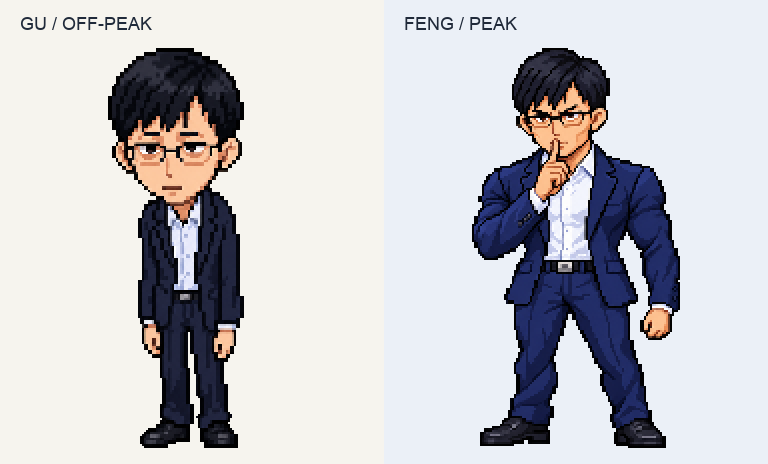
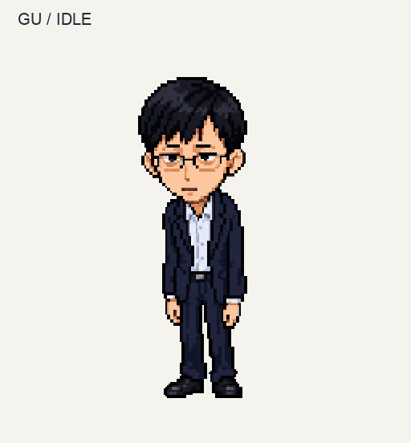
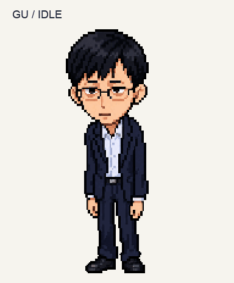
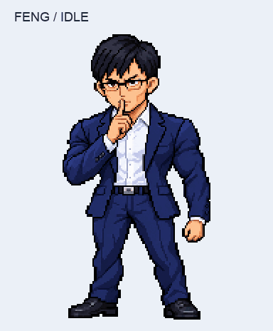
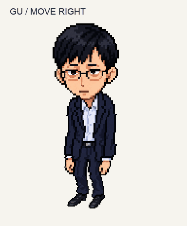
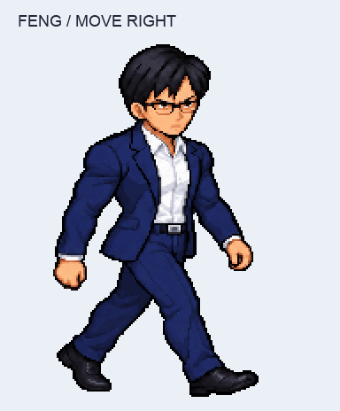
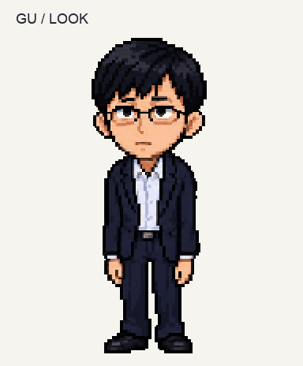
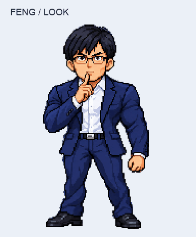

<h1 align="center">LIANG &amp; liang</h1>

<b>你的桌面，也有高峰和低谷。</b>

一位像素西装男，两种工作电量。会看你、跟着移动，也会在峰谷之间变身。

<a href="https://github.com/Roxin-ChaI/LIANG_and_liang/releases/tag/v0.1.1">下载 v0.1.1</a> · <a href="#motion">先看他动起来</a> · <a href="#download">选择 App 或桌宠素材包</a>

<h2>认识一下：梁文谷与梁文峰</h2>
<table>
<tr><th>梁文谷 · Gu</th><th>梁文峰 · Feng</th></tr>
<tr><td><b>低谷模式，省电陪伴。</b> 窄肩、微驼背、疲惫眼神。连被拖着移动，都带着一点「让我再歇会儿」的感觉。</td><td><b>高峰模式，气场上线。</b> 宽肩、挺拔、冷峻。同样的黑发、眼镜与西装，换上更有压迫感的工作姿态。</td></tr>
</table>

两个形态对应同一个角色的两种状态：<b>Gu 是低功耗的日常，Feng 是高峰时段的全力以赴。</b>名字里的「峰」与「谷」，也就是这套桌宠的时间设定。

<h2>为什么会变成另一个形态？</h2>

独立 App 按<b>北京时间</b>切换形态。到点后，先播放变身，再回到当前的待机或工作动作。

<table>
<tr><th>时间</th><th>桌面上的他</th></tr>
<tr><td>周一至周五 09:00–12:00、14:00–18:00</td><td><b>Feng · 梁文峰</b></td></tr>
<tr><td>午休、晚间，以及周六 / 周日</td><td><b>Gu · 梁文谷</b></td></tr>
</table>

Gu → Feng：10 帧　／　Feng → Gu：8 帧。这里将两个方向循环展示。

<blockquote>可以通过右键菜单手动切换形态。目前手动选择不会锁定形态，自动调度随后仍会按时间校正。</blockquote>

<h2 id="motion">他动起来是什么样？</h2>

形象之外，性格也在动作里。下面均使用 v0.1.1 当前选用的素材；GIF 为动作预览，不是操作录屏。

<h3>静静陪着你</h3>
<table class="motion">
<tr><th>Gu · 低能量待机</th><th>Feng · 克制待机</th></tr>
<tr><td></td><td></td></tr>
</table>

<h3>鼠标靠近，给你一点回应</h3>
<table class="motion">
<tr><th>Gu · 小幅悬停回应</th><th>Feng · 小幅悬停回应</th></tr>
<tr><td></td><td></td></tr>
</table>

<h3>同样是向右移动，反应却不一样</h3>
<table class="motion">
<tr><th>Gu · 像被拎起后颈，轻轻摆荡</th><th>Feng · 放下抵唇的手，向右迈步</th></tr>
<tr><td></td><td></td></tr>
</table>

这里展示原地动作循环；实际拖动时，桌宠窗口会跟随鼠标移动。左右两个方向均已制作。

<h3>你换个位置，他也会看过来</h3>
<table class="motion">
<tr><th>Gu · 四处观察</th><th>Feng · 四处观察</th></tr>
<tr><td></td><td></td></tr>
</table>

GIF 顺序展示 16 个方向；App 中由鼠标所在方向驱动，不会自行匀速转圈。

<h2>工作的时候，也能陪你一起</h2>

独立 App 可通过已验证的 Codex Desktop Hook 接收工具执行和回合结束事件：工具开始时进入工作动作，回合结束后回到待机。变身期间会保留任务状态，完成后继续对应动作。

等待、审查等工作状态也可从右键菜单选择。Hook 为可选配置，需要本机路径设置与人工授权；不是下载安装后自动连接所有事件。

<h2 id="download">选一种方式，把他放到桌面上</h2>
<table>
<tr><th>你想要什么</th><th>选择</th></tr>
<tr><td><b>完整的双形态、变身和时间调度</b></td><td><a href="https://github.com/Roxin-ChaI/LIANG_and_liang/releases/download/v0.1.1/LIANG_and_liang-v0.1.1-macos-arm64.zip">独立 macOS App · Apple Silicon</a></td></tr>
<tr><td><b>在 Codex 里使用这个角色</b></td><td>Codex Pet v2：<a href="https://github.com/Roxin-ChaI/LIANG_and_liang/releases/download/v0.1.1/LIANG_and_liang-v0.1.1-codex-v2-gu.zip">Gu 素材包</a> · <a href="https://github.com/Roxin-ChaI/LIANG_and_liang/releases/download/v0.1.1/LIANG_and_liang-v0.1.1-codex-v2-feng.zip">Feng 素材包</a></td></tr>
<tr><td><b>在 DeepSeek Harness 里使用</b></td><td>兼容 Codex v2 的 DSH 桌宠插件：<a href="https://github.com/Roxin-ChaI/LIANG_and_liang/releases/download/v0.1.1/LIANG_and_liang-v0.1.1-dsh-v2-gu.zip">Gu 素材包</a> · <a href="https://github.com/Roxin-ChaI/LIANG_and_liang/releases/download/v0.1.1/LIANG_and_liang-v0.1.1-dsh-v2-feng.zip">Feng 素材包</a></td></tr>
</table>

<a href="https://github.com/Roxin-ChaI/LIANG_and_liang/releases/download/v0.1.1/LIANG_and_liang-v0.1.1-pet-formats.zip">下载全部素材格式（含 DSH 旧版兼容包）</a> · <a href="https://github.com/Roxin-ChaI/LIANG_and_liang/releases/tag/v0.1.1">完整 Release / 校验文件</a>

<b>素材包与独立 App 的能力不同：</b>Codex / DSH 素材包提供单个形态的动画，由宿主决定触发与播放方式；不包含本项目的自动变身和时间调度。Gu/Feng 保持同一 Pet ID，二选一使用。DSH 包已通过格式校验，真机导入尚未验收。

下载前了解：当前版本与使用限制

<ul>
<li>v0.1.1 是本机开发预览版本，macOS 构建面向 Apple Silicon，仍保留部分本机路径依赖。</li>
<li>App 使用 ad-hoc 签名，尚未做 Apple Developer ID 签名或公证；不要为运行本项目关闭系统安全机制。</li>
<li>首次启动新版前，请正常退出旧桌宠，避免重复窗口或 Hook 接收器冲突。</li>
<li>不会修改 Codex 安装包；旧 runtime patch 实验仅保留作历史记录。</li>
</ul>

给想继续了解或参与开发的人

<ul>
<li><a href="standalone-app/README.md">本地构建与运行</a></li>
<li><a href="docs/pet-format-exports.md">Codex / DSH 素材格式与使用说明</a></li>
<li><a href="docs/releases/v0.1.1.md">v0.1.1 修改记录</a></li>
<li><a href="docs/releases/v0.1.1-validation.md">验收范围与已知限制</a></li>
</ul>

仓库保留开发历史及失败候选。当前 App 的素材选择以 <code>standalone-app/asset-overrides.json</code> 为准。

